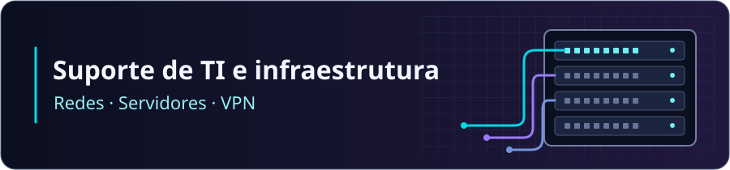

<div align="center">



<p align="center">
  
</p>

**Desenvolvimento de software** · **Automação** · **Infraestrutura & Redes**

<sub>Transformando problemas reais em soluções com tecnologia.</sub>

<p>
<a href="https://brunorobertocataneo.github.io/meu-novo-portfolio/"></a>
<a href="https://www.linkedin.com/in/bruno-roberto-cataneo-0b38132a5"></a>
<a href="mailto:bruno31.cataneo@gmail.com"></a>
</p>

</div>

---

### `root@bruno:~$ whoami`

```yaml
name: Bruno Roberto Cataneo
location: Videira, Santa Catarina, Brasil
education: Ciência da Computação - UNOESC
areas:
  - Desenvolvimento de software
  - Automação de processos
  - Suporte e infraestrutura de TI
currently_learning:
  - Redes e servidores
  - Cibersegurança
  - Desenvolvimento backend
```

Sou estudante de **Ciência da Computação na UNOESC** e atuo com tecnologia, suporte de TI e redes. Desenvolvo aplicações web, sistemas com banco de dados e automações voltadas a problemas práticos. Tenho interesse em aprofundar meus conhecimentos em **backend, infraestrutura e segurança da informação**.

### `root@bruno:~$ ls ./tech-stack`

<div align="center">

**Linguagens**

&nbsp;
&nbsp;
&nbsp;
&nbsp;
&nbsp;
&nbsp;


**Frameworks, bancos e ferramentas**

&nbsp;
&nbsp;
&nbsp;
&nbsp;
&nbsp;
&nbsp;
&nbsp;


</div>

### `root@bruno:~$ cat featured-projects.md`

| Projeto | Tecnologias | O que demonstra |
|:--|:--|:--|
| 🎬 **[Vision Cinemas](https://github.com/brunorobertocataneo/REDE-CINEMA-FINAL)** | Java, Spring Boot, MySQL, HTML, CSS, JavaScript | Aplicação full-stack com API, autenticação, sessões e ingressos |
| ⚙️ **[MonitorRenova](https://github.com/brunorobertocataneo/Monitorrenova)** | PHP, MySQL, Docker, n8n | Demonstração acadêmica de acompanhamento de renovações e regras de negócio; fluxo n8n independente |
| 🛡️ **[ERS Seguros](https://github.com/brunorobertocataneo/ERS)** | HTML, CSS, JavaScript | Site corporativo responsivo, temas e contato via WhatsApp |
| 🌐 **[Portfólio Pessoal](https://github.com/brunorobertocataneo/meu-novo-portfolio)** | HTML, CSS, JavaScript | Galeria de projetos, carrossel e navegação responsiva |
| 🧠 **[Jogo da Memória](https://github.com/brunorobertocataneo/programming_memory_game)** | JavaScript, HTML, CSS | Jogo interativo publicado na web |
| 💍 **[Nosso Grande Dia](https://github.com/brunorobertocataneo/nosso-grande-dia.)** | HTML, CSS, JavaScript | Protótipo visual de lista de presentes com cotas simuladas, sem pagamentos reais |

### `root@bruno:~$ git stats`

<div align="center">


</div>

### `root@bruno:~$ ./connect.sh`

<div align="center">

<a href="https://www.linkedin.com/in/bruno-roberto-cataneo-0b38132a5"></a>
<a href="mailto:bruno31.cataneo@gmail.com"></a>
<a href="https://brunorobertocataneo.github.io/meu-novo-portfolio/"></a>

<sub>⚡ Code • Learn • Build • Repeat</sub>

</div>
